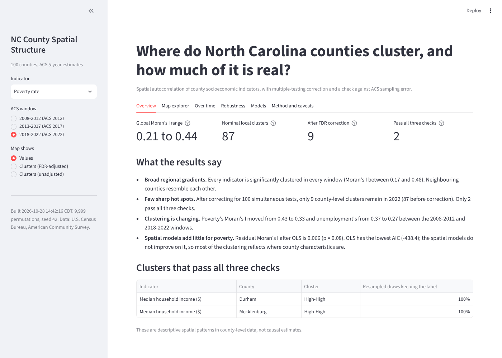
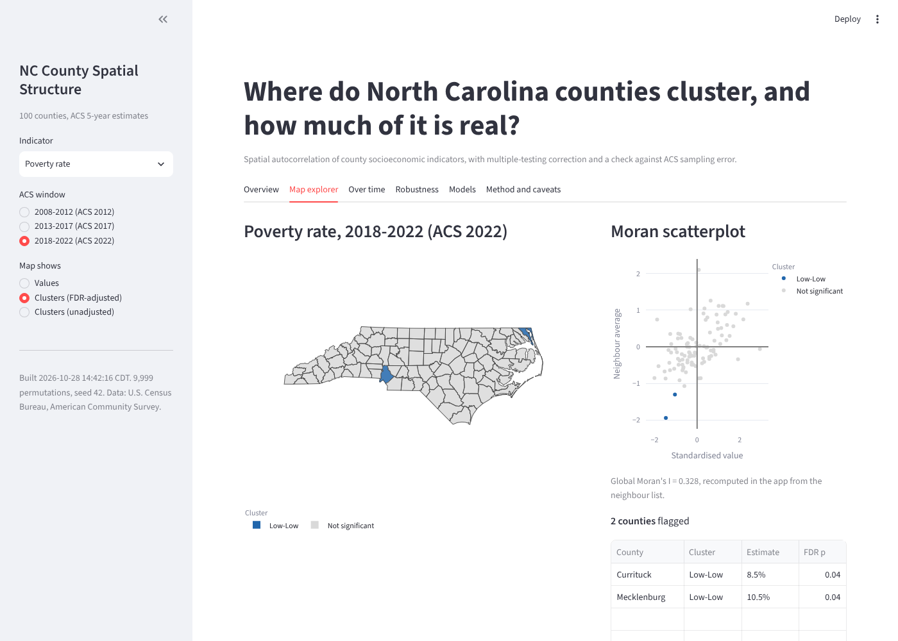

# NC County Spatial Structure

Where do North Carolina counties cluster on socioeconomic conditions, how has that changed, and **how much of it survives multiple-testing correction and ACS sampling error?**

An R pipeline computes spatial autocorrelation (global and local Moran's I), checks every result against the margins of error published with the American Community Survey, and fits spatial regression models. A Streamlit app presents the results.



**Live app:** _add the Streamlit Community Cloud URL here after deploying (see [Deploy](#deploy-the-app))._

## Key findings

ACS 5-year estimates, three non-overlapping windows (2008-12, 2013-17, 2018-22), six indicators, 100 counties.

- **Broad regional gradients, not sharp hot spots.** Every indicator is significantly clustered in every window (global Moran's I between 0.17 and 0.48). But after Benjamini-Hochberg correction for 100 simultaneous tests, only 9 county-level clusters remain in 2018-22, against 87 nominally significant before correction.
- **Only two clusters pass all three checks in 2018-22** (significant after FDR correction, same label under the analytic test, and stable in at least 90% of draws resampled within the ACS margins of error): the high-income clusters in Durham and Mecklenburg counties. The same check on the earlier windows finds one robust cluster in 2008-12 (a high-unemployment cluster in Martin County) and none in 2013-17, so robust clusters are rare in every window.
- **Margins of error matter most for unemployment.** Its median relative margin of error is 23% of the estimate (up to 95% for some small counties), and none of its 16 nominally significant clusters in 2018-22 is stable under resampling.
- **Clustering is changing.** Poverty's Moran's I fell from 0.43 to 0.33 and unemployment's from 0.37 to 0.27 between the first and last window; median home value rose from 0.35 to 0.41.
- **Spatial regression models add little for poverty.** Residual Moran's I after OLS is 0.07 (p = 0.08) and OLS has the lowest AIC, so most of the clustering reflects where county characteristics are, not extra spillover between neighbours.

These are descriptive patterns in county-level data, not causal estimates. See [Caveats](#caveats).



## Quick start

### Run the app (Python 3.10+)

```bash
python -m venv .venv
source .venv/bin/activate            # Windows: .venv\Scripts\activate
pip install -r app/requirements.txt
streamlit run app/streamlit_app.py
```

Or double-click `start_app.bat` (Windows) / `start_app.command` (macOS). The app reads the committed result files in `app/data/`, so it needs neither R nor a Census API key.

### Rebuild the results (R 4.1+)

```bash
Rscript pipeline/install_packages.R      # once
# put your Census API key in ~/.Renviron:  CENSUS_API_KEY=your_key   (see .Renviron.example)
Rscript pipeline/run_all.R               # download -> analyse -> model -> export to app/data/
```

Run commands from the repository root. To reuse already downloaded data and skip the Census step: `SKIP_DOWNLOAD=1 Rscript pipeline/run_all.R`. A free key is available at <https://api.census.gov/data/key_signup.html>. The key is read from the environment and is never stored in the repository.

### Tests

```bash
pip install -r requirements-dev.txt && pytest -q tests   # app logic, data contract, smoke test of the app
Rscript tests/testthat.R                                  # spatial helpers on a synthetic grid
```

The Python tests include a cross-language check: Moran's I recomputed in pandas from the exported neighbour list equals the value computed in R for every indicator and window.

## How it works

```
Census API (tidycensus)
        |
 pipeline/R/01_data.R             ACS 5-year estimates + margins of error, county boundaries
        |
 pipeline/R/02_spatial_structure  global + local Moran's I (9,999 permutations, FDR), persistence over time,
        |                         margin-of-error resampling, sensitivity to spatial weights
 pipeline/R/03_spatial_models     OLS, Lagrange multiplier tests, spatial lag / error / Durbin models
        |
 pipeline/R/04_export             small CSV/GeoJSON files  ->  app/data/   (tracked in git)
        |
 app/streamlit_app.py             Overview, Map explorer, Over time, Robustness, Models, Method
```

- **Local clusters.** Local Moran's I with conditional permutation p-values; the headline classification uses Benjamini-Hochberg FDR correction because 100 counties are tested at once. Unadjusted clusters are shown for comparison.
- **Sampling error.** Each county estimate is redrawn 500 times from Normal(estimate, (MOE / 1.645)^2) (ACS margins of error are 90% intervals), then local Moran's I is recomputed. Ratio indicators carry propagated margins of error.
- **Models.** Poverty rate regressed on standardised predictors; income is excluded because it is nearly a mechanical function of poverty.
- **Reproducibility.** Fixed seeds throughout. The pipeline was rerun on a second machine (Linux, R 4.3.3) and reproduced the original results exactly: Moran's I, p-values, cluster labels, AIC and stability shares all matched.

## Repository layout

```
app/                    Streamlit app (streamlit_app.py), pure-pandas logic (analysis.py), result files (data/)
pipeline/               R pipeline: R/00_config ... R/04_export, run_all.R, install_packages.R
tests/                  pytest (app + data contract) and testthat (spatial helpers)
docs/                   screenshots
.github/workflows/      CI: pytest, testthat, and a committed-secrets guard
```

`data/` and `outputs/` (intermediate files, figures) are regenerated by the pipeline and are git-ignored.

## Deploy the app

The app is self-contained and uses only public Census-derived data, so it can be hosted publicly.

1. Push this repository to GitHub.
2. Go to <https://share.streamlit.io>, choose **New app**, select the repository and branch, and set the main file path to `app/streamlit_app.py`.
3. Streamlit Community Cloud installs `app/requirements.txt` automatically. Paste the resulting URL into this README.

## Caveats

- **Stability uses the unadjusted permutation test.** FDR correction at n = 100 needs p-values that a 999-permutation run inside a Monte Carlo loop cannot resolve, so stability asks whether a county keeps its cluster type at the nominal 5% level. A cluster that fails even this is fragile; one that passes is not proven robust.
- **Resampling is simplified.** County errors are treated as independent and Normal, ignoring correlation between neighbours and the skew of ratio estimates.
- **Method dependence.** Six of the nine FDR-significant clusters (Bertie and Northampton on income and on home value, Currituck and Mecklenburg on poverty) are significant under the permutation test but not the analytic test. They are reported but do not count as robust.
- **Descriptive, ecological analysis.** County aggregates only; no causal claims. Some model coefficients (for example a positive association of bachelor's degree share with poverty) probably reflect college counties and collinearity, and are flagged as hypotheses rather than findings.
- **Scope.** This is not an official index and is not a substitute for established measures such as the CDC/ATSDR Social Vulnerability Index or the NC Commerce county tier designations.

## Data and license

Data: U.S. Census Bureau, American Community Survey 5-year estimates, accessed with the `tidycensus` R package. This product uses the Census Bureau Data API but is not endorsed or certified by the Census Bureau.

Code: MIT License (see `LICENSE`).
